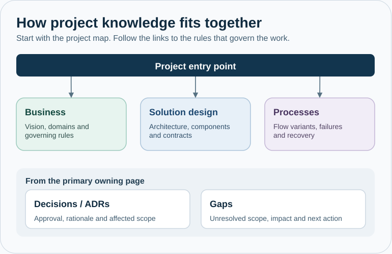

# Project knowledge

Start with `specs/index.md`. Link from it to the pages where people define
business rules, describe system boundaries and explain flows. An engineer
debugging a repeat request and a product owner checking policy should be able to
find the same rule. Follow those links before opening tickets or review history.



[Full-size diagram](assets/project-knowledge.svg) · [Editable Draw.io source](assets/project-knowledge.drawio)

## Cancelling a reservation

An approved support policy allows a member to cancel their own confirmed
reservation. Link to `reservations.md` from `specs/index.md`. On the linked
page, write the policy and the outcomes it governs.

```markdown
## Cancel a reservation

A member can cancel a confirmed reservation they own. After the first
request its state is cancelled. Repeating the cancellation leaves it
cancelled. Source: approved support policy, “Member cancellations.”
```

Give those outcomes stable scenario IDs in `specs/acceptance.yaml`.

```yaml
scenarios:
  - id: AC-CANCEL
    source: reservations.md#cancel-a-reservation
    verify:
      - "Observe the member's confirmed reservation change to cancelled."
  - id: AC-CANCEL-REPEAT
    source: reservations.md#cancel-a-reservation
    verify:
      - "Repeat the cancellation and verify that the reservation stays cancelled."
```

Keep independent behavior under a separate heading. Suppose the policy says
nothing about cancellation by a support agent. Add that question under
`## Support-assisted cancellation`, with the permission and privacy decision
the team needs. The member’s own cancellation can proceed if the reviewer
confirms it has no dependency on that decision.

If you ask the agent to implement this behavior, it prepares the
`member-cancellation` slice. The reviewer checks
`AC-CANCEL` and `AC-CANCEL-REPEAT` in
`reviews/readiness/member-cancellation.yaml`, together with the governing
decision, affected contracts and failure paths. The agent uses existing
approval for the reviewed scope or asks for your decision. It then handles
the ticket, verification and independent review at the implemented revision.

As the support policy becomes clearer, revise that section in place. The member
cancellation approval and its accepted ticket stay current. If a later policy
change alters a rule both paths depend on, review the slices that cite that rule
and revisit affected unfinished tickets. For work already accepted, plan a
follow-up wave that verifies the changed behavior against the current code.
Leave the original wave as evidence of what was accepted then. A wording
fix inside a bound section also changes its digest. Git preserves the earlier
sources and evidence. If readers need to know what is deployed, link to
release or implementation evidence for the exact revision. Keep that delivery
information outside the governing section so recording a release leaves the
slice approval current.

## Organize around ownership

| Reader's question | Owning page |
| --- | --- |
| What business outcome, terms and policy apply? | Vision or domain |
| Which boundaries and constraints shape the system? | Solution design |
| Who owns this interface, data or operational boundary? | Component |
| What starts the process, what can fail and how does it end? | Flow |

Use a single topic page when it answers the question. Split it when the
ownership, recovery behavior or outcome diverges. Group comparable variants
under stable headings. Link directly to the governing rule and interface.
When wording changes, edit its owner and inspect the links, scenarios and
diagrams whose meaning could change. Review covers the selected outcome and any sources it depends on.

## Decisions, gaps and meetings

Use an architectural decision record (ADR) to explain a material business,
technical or mixed choice. Put it near the affected subject. Keep a short
overview when people need to find several decisions. Record the options,
chosen outcome, consequences and approval evidence. An ADR can be
`proposed`, `accepted` or `superseded`. Apply an accepted choice to the
governing rule.

Put open questions next to the affected rule. Name the missing decision, what
depends on it and how to move it forward. Add a decision-maker when that helps.
Use a separate linked page for a larger investigation. Once the team decides,
update the rule and remove the open question. Git records the change.

Record applicable failure paths through their final outcomes. For a retriable
operation, cover duplicate protection, retry limits, escalation and the last
observable state. Where automated recovery may stop, say who takes over.

Meeting notices, agendas and notes are optional. Keep them in the appropriate
access-controlled workspace. Record purpose, date and time zone, decisions
sought and next actions as appropriate. Transfer decisions into the owning
rule after confirming authority. If your project exchanges knowledge via OKF,
use its metadata conventions on the relevant Markdown pages. [OKF specification](https://github.com/open-knowledge-format/open-knowledge-format/blob/527e81aff55992be21507e97004286789126f88c/SPEC.md)

## Files a small project needs

| When | Files |
| --- | --- |
| Explore an idea | `specs/index.md` |
| Define testable behavior | Add `specs/acceptance.yaml` |
| Approve a slice | Add `reviews/readiness/<slice-id>.yaml` and link the existing review and approval evidence |
| Plan and implement it | Add the ticket and, when ready, its progress JSON |

Ordinary Markdown pages need no frontmatter. Add metadata if a renderer or
an integration needs it. The slice records live outside the published spec
tree.

## Draw and publish

Choose the diagram for the reader's question. A context view shows neighboring
systems. A state or sequence view can make retries, ordering and recovery
clearer. Keep the editable Draw.io source and exported SVG or PNG beside the
owning explanation or in its linked assets. Check the export at normal and
narrow widths for legible labels, clear direction, contrast and unclipped text.
Describe the important paths in nearby Markdown and provide a full-size link.

This repository's human guides can be previewed locally with MkDocs 1.6.1.
From the repository root, build or start the preview:

```bash
mkdocs build --strict
mkdocs serve
```

For a full internal preview in your own project, point `docs_dir` at `specs`.
For a public or limited audience, stage only reviewed pages and assets and
build from that directory. MkDocs copies files outside the sidebar too. Check
the built HTML, search index and static files for private meeting notes,
approval evidence, restricted contracts and embedded diagram data. [MkDocs configuration](https://www.mkdocs.org/user-guide/configuration/#exclude_docs)
